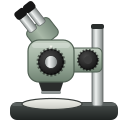

# Scope Recorder

Live view and H.264 recording for a [The Imaging Source](https://www.theimagingsource.com) USB3 Vision camera mounted on a dissecting microscope. It was built for recording surgeries: start it, check the picture, press Ctrl+R. Everything works from the keyboard.

Two versions share the same controls and output format:

| | [`cpp/`](cpp/) (recommended) | [`python/`](python/) |
|---|---|---|
| Pipeline | Raw Bayer → CUDA debayer → NVENC, all on the GPU | IC4 debayer (CPU) → ffmpeg NVENC |
| CPU while recording¹ | ~18% of one core | ~78% of one core |
| Frame timing | Camera hardware clock (exact) | Nominal frame rate |
| Needs | NVIDIA GPU, CUDA, Qt 6, FFmpeg dev libs | Python 3.12+, uv, ffmpeg |

¹ 1920×1200 at 30 fps on an Intel i5-6600 with an NVIDIA T400.

## Features

- **Live view** at full frame rate, letterboxed to the window.
- **Recording (Ctrl+R):** H.264 in fragmented MP4, so a crash loses only the last ~2–3 s. Each recording also gets a CSV with the camera's frame number and hardware timestamp for every frame, so dropped frames are detectable.
- **Metadata sidecar per recording** (`<recording>.json`), for methods sections and reproducibility: start and stop times, frames written and dropped, measured frame rate, encoder settings, the app version, and the camera's settings (model, serial, exposure, gain, white balance, gamma, and more) captured at start and at stop, plus IC4's complete settings dump.
- **Quality presets (Ctrl+E):** Very high / High / Standard / Compact (constant quality).
- **Camera settings (Ctrl+P):** exposure, gain, white balance, frame rate, gamma, black level and image flip. Keyboard-driven, with auto values shown live. Settings persist between sessions.
- **Snapshot (Ctrl+S):** full-resolution PNG.
- Free-disk-space display, a camera-disconnect warning, and a "Stop recording and quit?" safeguard.

Recordings are saved to `~/Videos/ScopeRecordings/` by default.

## Hardware

Developed and tested with a **DFK 33UX174** (Sony IMX174, 1920×1200, BayerGB8) on Arch Linux (Wayland/Hyprland) with an **NVIDIA T400**. Other TIS USB3 Vision colour cameras should work with the Python version. The C++ version's GPU debayer currently assumes the GBRG Bayer pattern (see `cpp/src/GpuFrames.cu`).

## Setup

### 1. TIS camera driver (both versions)

Download **"GenTL Producer / IC4 Driver"** for Linux (`ic4-gentl-driver-usb3vision_<version>_amd64.deb`) from [TIS downloads](https://www.theimagingsource.com/en-us/support/download/).

- **Ubuntu/Debian:** `sudo apt install ./ic4-gentl-driver-usb3vision_*_amd64.deb`
- **Arch and others:** `sudo scripts/install_tis_driver.sh path/to/ic4-gentl-driver-usb3vision_*_amd64.deb`

Then unplug and replug the camera.

### 2. Pick a version

- **C++ / GPU:** see [`cpp/README.md`](cpp/README.md). Fetch the IC4 SDK with `scripts/fetch_ic4_sdk.sh`, then build with CMake.
- **Python:** see [`python/README.md`](python/README.md). Run `uv run scope_recorder.py`.

Only one program can use the camera at a time.

## Licence

This project's code is under the [MIT licence](LICENSE).

The Imaging Source's driver and IC4 SDK are proprietary, are **not** included here, and are used under TIS's own licence terms. The scripts above unpack them from your own downloads. The Python version installs TIS's `imagingcontrol4` package from PyPI.

Developed with [Claude Code](https://claude.com/claude-code).
